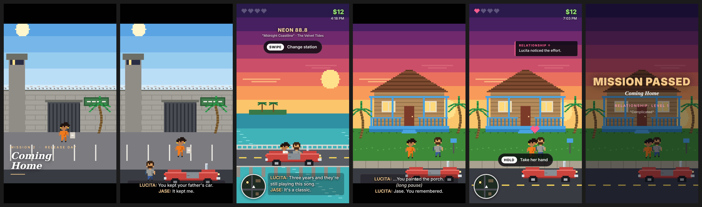

# Storyboard

Characters: **Lucita Caminito** and **Jase Duvalet** (see [characters](characters.md)). Setting: **Port Mangrove** (placeholder).

Each panel lists what's on screen, the text, the UI and the audio. Text is always written at full-game fidelity; the visuals are simple NES-scale pixel art (characters about 16×32 game pixels).

Frames are rendered from [`storyboard/frames.html`](storyboard/frames.html) with `node tools/render-storyboard.js` (or `... b2` for one beat; needs Playwright). The game layer is 180×320 pixels scaled 2×; UI and text render at full resolution on purpose.

## Beat outline

1. **The House:** Lucita is in prison. Jase fixes up the house before she gets out.
2. **Coming Home:** Jase picks her up in his father's convertible. She notices the porch.
3. **The Store:** a convenience store hold-up, done as a couple.
4. **The Date:** kayaking at sunset.
5. **The Text:** a message arrives mid-heist ("did u get the oat milk").
6. **The Channel:** a speedboat chase.
7. **The Job:** the big heist, planned and played with total seriousness.
8. **The Ending:** relationship level decides it; epilogue on the in-game social feed.

The radio is reachable from every vehicle, including the kayak.

---

## Beat 1: The House (draft 2)

**Panel 1: Cold open** *(not drawn)*
- *Screen:* Black. White text fades in.
- *Text:* `Port Mangrove. 1,094 days since Lucita went inside.`
- *Audio:* Low synth drone, then a 3-note sad melody that loops.

**Panel 2: Establishing shot** *(frame 1)*
- *Screen:* Banded sunset sky. A weathered wooden house: a blue tarp on the roof, two holes, a boarded window, a gray porch with missing rails. Palms either side, a mailbox. Jase stands on the lawn. Cinematic letterbox bars.
- *UI:* Mission card, italic serif: **Where the Heart Is**, kicker `Mission 1 · Port Mangrove`.
- *Audio:* A seagull, at full fidelity: the only realistic sound in the game.

**Panel 3: Phone call** *(frame 2)*
- *Screen:* Scene dims. A phone slides up, rendered at far higher resolution than the world. Caller: Ma.
- *Text:*
  - Ma: "You eating, baby?"
  - Jase: "I'm fixing up the house, Ma. Before she gets out."
  - Ma: "That house has been falling down since your daddy."
  - Jase: "Then it's about time somebody picked it up."
- *Audio:* Low-passed babble voice.

**Panel 4: Repair gameplay** *(frame 3)*
- *Screen:* Three glowing hotspots: roof, bathroom window, porch rail. A strip of roof is already re-shingled in a slightly different brown.
- *Prompts:*
  - `HOLD Re-shingle the roof` → the roof rows change to a slightly different brown.
  - `RAPID TAP Re-grout the bathroom` → nothing visible changes. Toast: `Skill increased — Grout: Professional Grade`.
  - `SWIPE Paint the porch` → the whole porch turns blue.
- *UI:* Full HUD: 4 empty hearts, money, clock, minimap. `Home Restoration 34% → 67% → 100%`.
- *Audio:* Rich hammering per tap; chiptune drum roll on completion.

**Panel 5: Quiet moment** *(frame 4)*
- *Screen:* The house restored: new roof, windows lit, porch and mailbox painted blue. Jase sits on the steps. The sun has dropped.
- *Text (italic monologue):* *"She used to say the porch was the only part of this house that was hers. Three years. I hope blue is still her color."*
- *Prompt (before this frame):* `HOLD Sit on the porch steps.`
- *UI:* Station card: `SMOOTH SENIORS 101.1 — "Gloria's Song (For Gloria)" · DJ Merle`.
- *Audio:* Radio fades in from inside, DJ mid-dedication: "...this one goes out to Gloria, who passed in March. She'd have loved this saxophone."

**Panel 6: End card** *(frame 5)*
- *UI:* `MISSION PASSED — Where the Heart Is` / `Hidden effect logged` / `Someone will notice.`
- Sets the porch flag that pays off in Beat 2.

---

## Beat 2: Coming Home (draft 1)

**Panel 1: Release** *(frame 1)*
- *Screen:* Harsh, flat midday sky. Concrete prison wall with razor wire, a guard tower, a barred gate. Lucita walks out in the orange jumpsuit, carrying a paper bag of belongings. Letterbox.
- *UI:* Mission card: **Coming Home**, kicker `Mission 2 · Release Day`.
- *Audio:* No music. A gate buzzer, a long metallic clunk, cicadas.

**Panel 2: The curb** *(frame 2)*
- *Screen:* The red convertible at the curb, top down: sun-faded paint, one primer-gray door. Jase stands beside it. Lucita stops halfway across the lot.
- *Text:*
  - Lucita: "You kept your father's car."
  - Jase: "It kept me."
- *Prompt (after the line):* `HOLD Open her door.` Relationship cue only; no meter change yet.

**Panel 3: The drive** *(frame 3)*
- *Screen:* Sunset causeway over teal shallows, a distant key with two palms. The convertible crosses with both of them visible over the doors.
- *UI:* Full HUD. Station card `NEON 88.8 — "Midnight Coastline" · The Velvet Tides`. Prompt `SWIPE Change station`.
- *Text:* A long silence first (about 6 seconds of nothing but the loop). Then:
  - Lucita: "Three years and they're still playing this song."
  - Jase: "It's a classic."
- *Joke:* the "song" is a 4-second loop. If the player swipes, every station is also mid-loop. If the player doesn't swipe, Lucita eventually changes it herself: `Lucita changed the station.`
- *Audio:* Neon 88.8 loop; the DJ cuts in once: "That was 'Midnight Coastline.' Here it is again."

**Panel 4: The porch** *(frame 4)*
- *Screen:* Home at sunset. The convertible parked on the street. Lucita, still in the jumpsuit, faces the blue porch. Jase hangs back. Letterbox.
- *Text:*
  - Lucita: "...You painted the porch."
  - *(long pause)*
  - Lucita: "Jase. You remembered."
- *Condition:* if Beat 1's porch was skipped, she says only: "...It's still standing." No heart.

**Panel 5: Take her hand** *(frame 5)*
- *Screen:* They stand together. A pixel heart rises between them.
- *Prompt:* `HOLD Take her hand.`
- *UI:* First heart fills. Toast: `Relationship ↑ — Lucita noticed the effort.`
- *Audio:* A single warm chiptune chord.

**Panel 6: End card** *(frame 6)*
- *UI:* `MISSION PASSED — Coming Home` / `Relationship: Level 1` / `"Complicated"`

## Beats 3–8

To be drafted.

## Running ideas

- Loading-screen tips: "TIP: Partners appreciate thoughtful gestures. Remember birthdays."
- Stats page: `Mangroves Paddled: 1`, `Hands Held: 3`.
- Fake 30-second "compiling shaders" bar on a game made of a few dozen rectangles.
- Option to leave Lucita in prison; a counter quietly tracks days. Fishing is very peaceful.
- Relationship meter: 4 pixel-hearts, with level names ("Complicated", ...). Ignoring texts decays it.
- Lucita changes the radio station herself if you don't.
