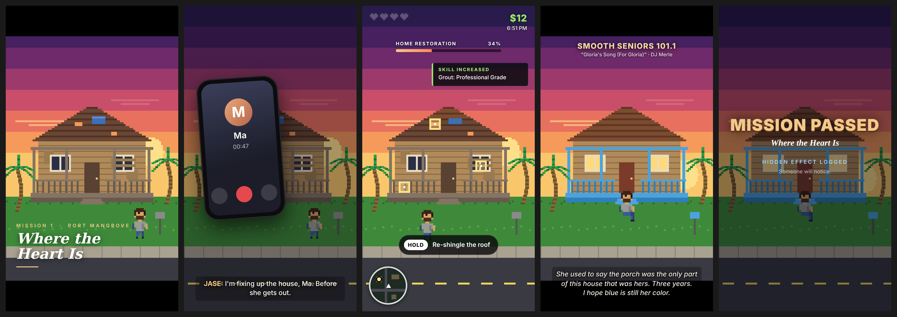
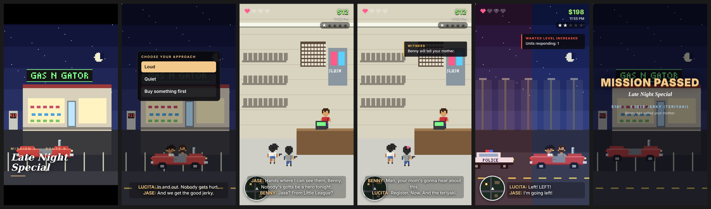
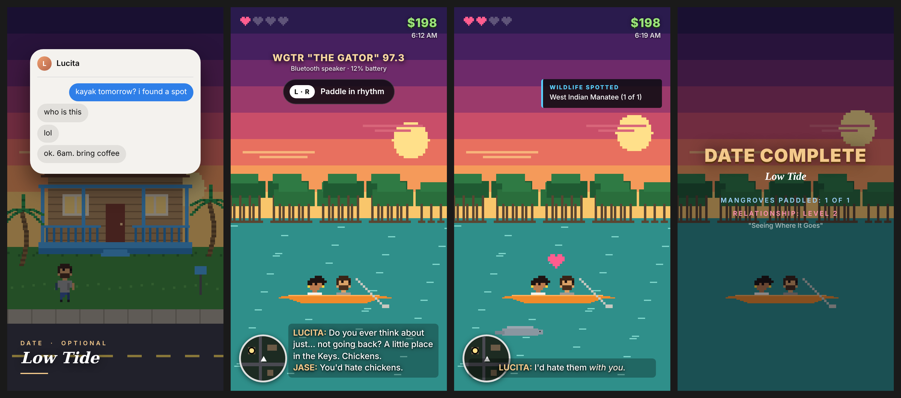
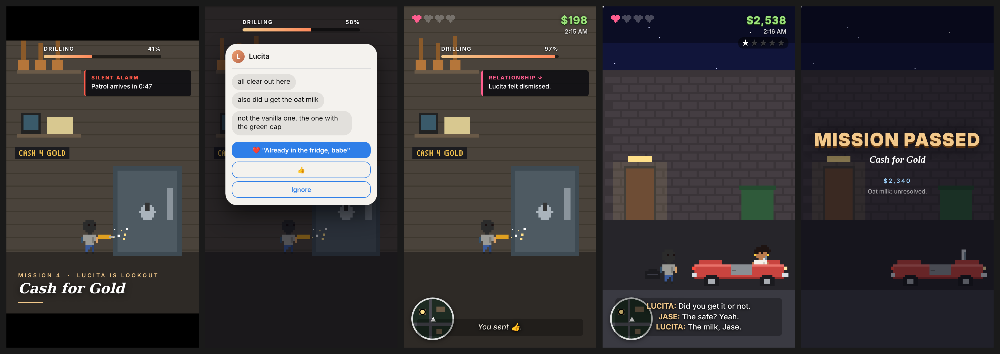
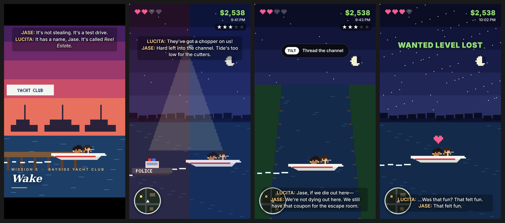
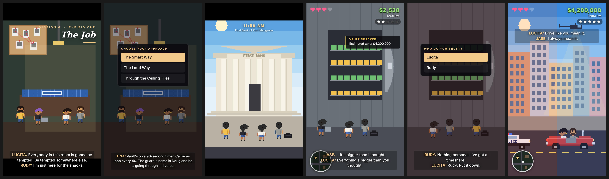
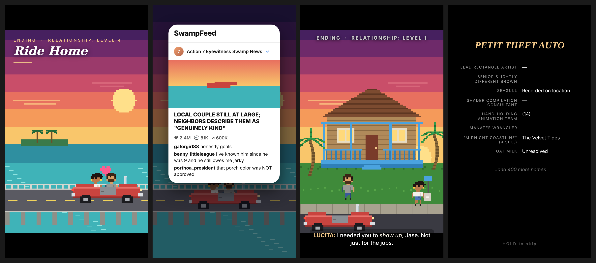

# Storyboard

Characters: **Lucita Caminito** and **Jase Duvalet** (see [characters](characters.md)). Setting: **Port Mangrove** (placeholder).

Each panel lists what's on screen, the text, the UI and the audio. Text is always written at full-game fidelity; the visuals are simple NES-scale pixel art (characters about 16×32 game pixels).

Frames are rendered from [`storyboard/frames.html`](storyboard/frames.html) with `node tools/render-storyboard.js` (or `... b2` for one beat; needs Playwright). The game layer is 180×320 pixels scaled 2×; UI and text render at full resolution on purpose.

## Beat outline

1. **The House:** Lucita is in prison. Jase fixes up the house before she gets out.
2. **Coming Home:** Jase picks her up in his father's convertible. She notices the porch.
3. **The Store** (*Late Night Special*): a convenience store hold-up, done as a couple. The clerk knows Jase from Little League.
4. **The Date** (*Low Tide*, optional): kayaking at dawn; a manatee.
5. **The Text** (*Cash for Gold*): Lucita is lookout, and texts mid-safecrack: her sister's stolen ring is in the shop window.
6. **The Channel** (*In Deep Water*): a stolen speedboat, a helicopter, a mangrove channel.
7. **The Job**: the big bank heist with a crew; a betrayal; a five-star getaway.
8. **The Ending**: relationship level decides it; epilogue on the in-game social feed; very long credits.

The radio is reachable from every vehicle, including the kayak.

---

## Beat 1: The House (draft 2)

**Panel 1: Cold open** *(not drawn)*
- *Screen:* Black. White text fades in.
- *Text:* `Port Mangrove. 1,094 days since Lucita went inside.`
- *Audio:* Low synth drone, then a 3-note sad melody that loops.

**Panel 2: Establishing shot** *(frame 1)*
- *Screen:* Banded sunset sky. A weathered wooden house: a blue tarp on the roof, two holes, a boarded window, a gray porch with missing rails. Palms either side, a mailbox. Jase stands on the lawn. Cinematic letterbox bars.
- *UI:* Mission card, italic serif: **Where the Heart Is**, kicker `Mission 1 · Port Mangrove`.
- *Audio:* A seagull, at full fidelity: the only realistic sound in the game.

**Panel 3: Phone call** *(frame 2)*
- *Screen:* Scene dims. A phone slides up, rendered at far higher resolution than the world. Caller: Ma.
- *Text:*
  - Ma: "You eating, baby?"
  - Jase: "I'm fixing up the house, Ma. Before she gets out."
  - Ma: "That house has been falling down since your daddy."
  - Jase: "Then it's about time somebody picked it up."
- *Audio:* Low-passed babble voice.

**Panel 4: Repair gameplay** *(frame 3)*
- *Screen:* Three glowing hotspots: roof, bathroom window, porch rail. A strip of roof is already re-shingled in a slightly different brown.
- *Prompts:*
  - `HOLD Re-shingle the roof` → the roof rows change to a slightly different brown.
  - `RAPID TAP Re-grout the bathroom` → nothing visible changes. Toast: `Skill increased — Grout: Professional Grade`.
  - `SWIPE Paint the porch` → the whole porch turns blue.
- *UI:* Full HUD: 4 empty hearts, money, clock, minimap. `Home Restoration 34% → 67% → 100%`.
- *Audio:* Rich hammering per tap; chiptune drum roll on completion.

**Choices and outcomes (as built)**

Mission 1 can't be failed, but it can be done badly. Results are saved as flags for later missions.

| Choice | Options | Effect |
|---|---|---|
| Ma's call | Ignore (about 8 s of ringing) | Voicemail: "I know you're not eating." Missed-call toast. |
| | "Yes, Ma." | Ma: "Mm-hm." |
| | "No, Ma." | Ma sends $10, note "FOR FOOD". Only way to afford everything. |
| | "Define eating." | Ma: "Don't you get smart with me." |
| Repairs ($12 budget) | Shingles $8, Grout $3, Paint $9 | Tap a job to buy supplies. Without Ma's $10 you can't do all three: practical (roof) or sentimental (porch). |

- End card shows `Home Restoration N%` (roof 34, grout 33, porch 33).
- Porch painted: monologue "I hope blue is still her color", Lucita notices in Beat 2 (+1 heart).
- Porch not painted: "I couldn't afford the blue. I hope she still likes gray."
- Roof not fixed: "And I hope it doesn't rain." Pays off in Beat 2 (it rains; a pot catches the drip).
- Ma ignored: she leaves another voicemail at the start of Beat 2.

**Panel 5: Quiet moment** *(frame 4)*
- *Screen:* The house restored: new roof, windows lit, porch and mailbox painted blue. Jase sits on the steps. The sun has dropped.
- *Text (italic monologue):* *"She used to say the porch was the only part of this house that was hers. Three years. I hope blue is still her color."*
- *Prompt (before this frame):* `HOLD Sit on the porch steps.`
- *UI:* Station card: `SMOOTH SENIORS 101.1 — "Gloria's Song (For Gloria)" · DJ Merle`.
- *Audio:* Radio fades in from inside, DJ mid-dedication: "...this one goes out to Gloria, who passed in March. She'd have loved this saxophone."

**Panel 6: End card** *(frame 5)*
- *UI:* `MISSION PASSED — Where the Heart Is` / `Hidden effect logged` / `Someone will notice.`
- Sets the porch flag that pays off in Beat 2.

---

## Beat 2: Coming Home (draft 1)

**Panel 1: Release** *(frame 1)*
- *Screen:* Harsh, flat midday sky. Concrete prison wall with razor wire, a guard tower, a barred gate. Lucita walks out in the orange jumpsuit, carrying a paper bag of belongings. Letterbox.
- *UI:* Mission card: **Coming Home**, kicker `Mission 2 · Release Day`.
- *Audio:* No music. A gate buzzer, a long metallic clunk, cicadas.

**Panel 2: The curb** *(frame 2)*
- *Screen:* The red convertible at the curb, top down: sun-faded paint, one primer-gray door. Jase stands beside it. Lucita stops halfway across the lot.
- *Text:*
  - Lucita: "You kept your father's car."
  - Jase: "It kept me."
- *Prompt (after the line):* `HOLD Open her door.` Relationship cue only; no meter change yet.

**Panel 3: The drive** *(frame 3)*
- *Screen:* Sunset causeway over teal shallows, a distant key with two palms. The convertible crosses with both of them visible over the doors.
- *UI:* Full HUD. Station card `NEON 88.8 — "Midnight Coastline" · The Velvet Tides`. Prompt `SWIPE Change station`.
- *Text:* A long silence first (about 6 seconds of nothing but the loop). Then:
  - Lucita: "Three years and they're still playing this song."
  - Jase: "It's a classic."
- *Joke:* the "song" is a 4-second loop. If the player swipes, every station is also mid-loop. If the player doesn't swipe, Lucita eventually changes it herself: `Lucita changed the station.`
- *Audio:* Neon 88.8 loop; the DJ cuts in once: "That was 'Midnight Coastline.' Here it is again."

**Panel 4: The porch** *(frame 4)*
- *Screen:* Home at sunset. The convertible parked on the street. Lucita, still in the jumpsuit, faces the blue porch. Jase hangs back. Letterbox.
- *Text:*
  - Lucita: "...You painted the porch."
  - *(long pause)*
  - Lucita: "Jase. You remembered."
- *Condition:* if Beat 1's porch was skipped, she says only: "...It's still standing." No heart.

**Panel 5: Take her hand** *(frame 5)*
- *Screen:* They stand together. A pixel heart rises between them.
- *Prompt:* `HOLD Take her hand.`
- *UI:* First heart fills. Toast: `Relationship ↑ — Lucita noticed the effort.`
- *Audio:* A single warm chiptune chord.

**Panel 6: End card** *(frame 6)*
- *UI:* `MISSION PASSED — Coming Home` / `Relationship: Level 1` / `"Complicated"`

**As built (Mission 2)**

- **Morning:** if the roof wasn't fixed, it's raining; tap the porch to put out a pot ("Pot deployed — Leak contained. Mostly."). The pot stays for the rest of the mission. If Ma was ignored she leaves a second voicemail ("I'm calling your aunt."); if you were honest she texts "did u buy a vegetable". HOLD to start the car.
- **Release and curb:** as storyboarded; HOLD to open her door (saved as `openedDoor`, unused so far).
- **The drive:** HOLD to drive (about 24 seconds of holding), SWIPE left/right to change station. The radio card shows what's on live, including ads and DJ lines as they're spoken. Lucita reacts once per station: Gator "...Fine.", Seniors "Are we old now?", WVIRAL "Absolutely not." (switches back), Talk "No news. Not today." (switches back). "Still playing this song" only comes up while a song is actually on. If you never touch the radio, she puts on The Gator herself at about two-thirds of the way ("This one. I missed this one."). Change away from her pick and she puts it back ("I was listening to that."); do it twice and she turns the radio off ("Okay. No radio."), saved as `drive.radioOff` and shown in the credits.
- **The porch:** porch painted → "You remembered." and the first heart. Not painted → "It's still standing." and "Relationship unchanged — She let you. She's thinking about it." Pot present → "Is that a pot?" / "It's load-bearing."
- **End card:** `Relationship: Level N` with the level name (0 is "It's Been a While").

## Relationship ladder

Four hearts. Level names appear on end cards.

| Level | Name | Typical point |
|---|---|---|
| 1 | "Complicated" | After Beat 2 |
| 2 | "Seeing Where It Goes" | After the date (Beat 4) |
| 3 | "Something Real" | After the channel (Beat 6) |
| 4 | "All In" | Trusting Lucita in Beat 7, plus no dismissed texts |

Hearts go down for: dismissive replies (👍), ignoring texts, trusting Rudy, skipping the date. The frames from Beat 6 on assume the ❤️ reply in Beat 5.

---

## Beat 3: The Store (draft 1)

**Panel 1: Arrival** *(frame 1)*
- *Screen:* Night. The Gas N Gator: neon green sign, lit windows with shelves, a pump showing `419`. The convertible pulls in. Letterbox.
- *UI:* Mission card **Late Night Special**, kicker `Mission 3 · Route 9`.
- *Audio:* Buzzing neon. Crickets. The car radio is still on, faintly.

**Panel 2: The plan** *(frame 2)*
- *Screen:* Both in the parked car. Scene dims for a choice.
- *Text:*
  - Lucita: "In and out. Nobody gets hurt."
  - Jase: "And we get the good jerky."
- *Choice:* `Loud` / `Quiet` / `Buy something first`. ("Buy something first" plays the same robbery, but Jase pays for a slushie before pulling the gun. Benny is more confused.)

**Panel 3: The hold-up** *(frame 3)*
- *Screen:* Interior under fluorescent light: shelves, a slush machine, a cigarette rack. Benny behind the counter in a red uniform. Lucita and Jase in ski masks, pistols up.
- *UI:* Full HUD; 1 wanted star.
- *Text:*
  - Jase: "Hands where I can see them, Benny. Nobody's gotta be a hero tonight."
  - Benny: "Jase? From Little League?"

**Panel 4: Recognized** *(frame 4)*
- *Screen:* Same shot. One pink pixel appears on Jase's mask (he's blushing).
- *UI:* Toast `Witness — Benny will tell your mother.`
- *Text:*
  - Benny: "Man, your mom's gonna hear about this."
  - Lucita: "Register. Now. And the teriyaki."

**Panel 5: The chase** *(frame 5)*
- *Screen:* Streetlights, red and blue wash. The convertible ahead, one police car behind.
- *UI:* 2 stars. Toast `Wanted level increased — Units responding: 1`.
- *Text:*
  - Lucita: "Left! LEFT!"
  - Jase: "I'm going left!"
- *Gameplay:* swipe lanes; 3 turns; lose the cruiser behind the car wash.

**Panel 6: End card** *(frame 6)*
- `MISSION PASSED — Late Night Special` / `$186 · 1 Beef Jerky (Teriyaki)` / `Benny has called your mother.`
- Follow-up: next time the phone opens, Ma has left a voicemail: "Benny's mother called my mother."

**As built (Mission 3)**

- **Approach:** Loud (2 stars; "EVERYBODY DOWN!" / "It's just me, man."), Quiet (1 star), Buy something first (1 star; $3 slushie, or Benny spots you if you're short; "Do you still want the slushie?" / "...Yes."). Benny: "...You know I gotta tell my mom."
- **Hold-up:** HOLD to keep Benny calm while the register empties. Let go for more than about a second: "Silent alarm — Benny pressed it with his knee." (+1 star). Haul: $186.
- **Jerky:** Teriyaki / Original ("I said teriyaki.") / Leave it ("Jase.").
- **Chase (first real fail state):** about 30 seconds. SWIPE up/down to change lanes; traffic, cones and the occasional gator come from the right, flagged by a blinking marker. Traffic never walls off both lanes at once, and you can't merge into a car beside you (a bump, "There's a car there!"). Cones and gators are bumps (a little lead lost, they get knocked off the road). Cars are serious: a big hit, the car rebounds, and the third car hit is **WRECKED** (CAR pips in the corner). Three called turns: the turn lane (left = top, right = bottom) is kept clear for a few seconds before Lucita calls it; get in that lane and swipe that way again. A turn screeches, slants the car, flashes to a different street, and the cruiser has to find you again. Lucita approves ("Yes! Like that."); miss it and "That was the turn!". The cruiser closes in from the left; if it catches you, **BUSTED**, and you retry the chase with a slightly bigger head start. Lucita's busted lines escalate: "We are not doing this again." / "We are doing this again." / "Jase. Left is the one on the left."
- **Escape:** a car wash, top down, then WANTED: you're clear. "...Did we just get the car washed?" / "Two birds." / "The top was down, Jase."
- **Radio:** Talk 1490 covers the porch (HOA) before this mission and the robbery after it.
- Balance (simulated): 1 star comfortable, 2 stars tight, 3 stars usually needs a retry; doing nothing is busted in about 8 seconds.

---

## Beat 4: The Date (draft 1)

Optional. Skipping it costs a heart later ("You never take me anywhere.").

**Panel 1: Asking** *(frame 1)*
- *Screen:* Jase on the lawn at sunset. A text thread fills most of the screen.
- *Text (thread):* Jase: "kayak tomorrow? i found a spot" / Lucita: "who is this" / "lol" / "ok. 6am. bring coffee"
- *UI:* Card **Low Tide**, kicker `Date · Optional`.

**Panel 2: Paddling** *(frame 2)*
- *Screen:* Dawn over a mangrove shoreline, teal water, an orange tandem kayak.
- *UI:* Station card `WGTR "THE GATOR" 97.3 — Bluetooth speaker · 12% battery`. Prompt `L · R Paddle in rhythm` (alternate thumbs; drifting out of rhythm turns the kayak in slow circles).
- *Text:*
  - Lucita: "Do you ever think about just... not going back? A little place in the Keys. Chickens."
  - Jase: "You'd hate chickens."

**Panel 3: The manatee** *(frame 3)*
- *Screen:* A manatee surfaces beside the kayak. A heart rises.
- *UI:* Toast `Wildlife spotted — West Indian Manatee (1 of 1)`. Second heart fills.
- *Text:* Lucita: "I'd hate them *with you.*"

**Panel 4: End card** *(frame 4)*
- `DATE COMPLETE — Low Tide` / `Mangroves paddled: 1 of 1` / `Relationship: Level 2 — "Seeing Where It Goes"`

**As built (Mission 4)**

- **Asking (text thread):** "kayak tomorrow? i found a spot" / "u up" ("it's 7pm jase" / "ask me properly") / "Don't ask". Not asking skips the date: Lucita texts "ok", `skippedDate` is saved (pays off later: "You never take me anywhere.").
- **Coffee:** she said bring coffee. At 5:48 AM a "Grab the coffee" prompt gives you 3.5 seconds. At the dock: "You brought coffee." or "No coffee."
- **Paddling:** the kayak waits empty at the dock until you get in. Tap the LEFT and RIGHT halves of the screen in turn (L / R hints light up). Same side twice spins the kayak ("We're going in circles.", then "Other side, Jase."). The Gator plays on a Bluetooth speaker the whole way.
- **Manatee:** at about 70% it surfaces. HOLD to sit still (within 7 seconds): it stays, "I'd hate them with you.", +1 heart ("A manatee was involved."). Fidget: "It left. You have to be still sometimes, Jase."
- **End card:** DATE COMPLETE, "Mangroves paddled: 1 of 1", relationship level.

---

## Beat 5: The Text (draft 1)

**Panel 1: The safe** *(frame 1)*
- *Screen:* Back room of the Cash 4 Gold pawn shop: guitars, a TV, boxes, a big safe. Jase in a mask, drilling; sparks. Letterbox.
- *UI:* `Drilling 41%`. Toast `Silent alarm — Patrol arrives in 0:47`. Card **Cash for Gold**, kicker `Mission 4 · Lucita is lookout`.
- *Audio:* Drill whine; a ticking clock under the music.

**Panel 2: The text** *(frame 2)*
- *Screen:* The heist keeps running behind a dimmed overlay. The drill progress keeps climbing while you read.
- *Text (thread, Lucita):* "all clear out here" / "also did u get the oat milk" / "not the vanilla one. the one with the green cap"
- *Choices:* `❤️ "Already in the fridge, babe"` / `👍` / `Ignore`
- *Design:* the alarm timer does **not** pause. Replying costs real seconds.

**Panel 3: Consequence** *(frame 3, the 👍 path)*
- *UI:* One heart drains. Toast `Relationship ↓ — Lucita felt dismissed.` Drilling hits 97%.
- *Text:* *You sent 👍.*
- *❤️ path:* toast `Relationship holds — She'll check the fridge.` *Ignore path:* a second text arrives at 99%: "ok."

**Panel 4: Escape** *(frame 4)*
- *Screen:* Back alley. Lucita is in the driver's seat. Jase runs out with a duffel bag.
- *UI:* `$2,538`, 1 star.
- *Text:*
  - Lucita: "Did you get it or not."
  - Jase: "The safe? Yeah."
  - Lucita: "The milk, Jase."

**Panel 5: End card** *(frame 5)*
- `MISSION PASSED — Cash for Gold` / `$2,340` / `Oat milk: unresolved.`
- Running gag: an `Oat milk` entry stays in the stats page as "Unresolved" until a hidden errand near the ending.

**As built (Mission 5)**

- **Drop-off:** if the store was robbed, Ma's voicemail: "Benny's mother called me. We'll talk about it." Lucita: "I'll be out front. I'll text you." / Jase: "It's a pawn shop. What could happen."
- **The drill:** HOLD to drill (about 20 seconds of drilling). Heat rises while held and falls when you let go; at full heat the drill jams for 3 seconds and restarts warm. Drilling in rhythm (hold about 3 s, rest about 1 s) works; holding nonstop does not.
- **Patrol timer:** 45 seconds (plus 6 per retry). Run out: BUSTED ("i said patrol was coming"), retry the drill.
- **The text** arrives at 50%: "jase. front window. gold ring w the little green stone" / "that's marisol's. her quince ring. somebody stole it in march" / "can u grab it??". While the thread is open you can't drill, and the timer keeps running. Replies: ❤️ "On it" / "No time, babe" / Ignore (then a text: "ok."). The ring glints in the window case.
- **The ring:** only if the safe opens with 8+ seconds left on the patrol clock: Grab the ring (walk to the case, HOLD to pop it) or leave it. Otherwise "No time for the window".
- **Escape:** "Did you get it?" / "The safe? Yeah." / "Jase." Got the ring: "That's hers. That's really hers.", +1 heart. Promised and didn't: "You said you were on it.", -1. Said no time and didn't: no change. Ignored her: -1. End card: $2,340, "Marisol's ring: recovered." or "still in the window."
- Tested: rhythm opens the safe with about 11 seconds left; holding nonstop gets busted.

---

## Beat 6: The Channel (draft 1)

**Panel 1: The marina** *(frame 1)*
- *Screen:* Sunset over the Bayside Yacht Club: silhouetted yachts, a dock, a white speedboat with a red stripe. Letterbox.
- *UI:* Card **In Deep Water**, kicker `Mission 5 · Bayside Yacht Club`.
- *Text:*
  - Jase: "It's not stealing. It's a test drive."
  - Lucita: "It has a name, Jase. It's called *Reel Estate.*"

**Panel 2: The chase** *(frame 2)*
- *Screen:* Night water. A helicopter's spotlight sweeps the boat. A police boat behind. Red and blue wash.
- *UI:* 3 stars.
- *Text:*
  - Lucita: "They've got a chopper on us!"
  - Jase: "Hard left into the channel. Tide's too low for the cutters."
- *Gameplay:* stay out of the spotlight cone; it follows with a delay.

**Panel 3: The channel** *(frame 3)*
- *Screen:* A narrowing mangrove channel, dark walls of roots on both sides.
- *UI:* Prompt `TILT Thread the channel`.
- *Text:*
  - Lucita: "Jase, if we die out here—"
  - Jase: "We're not dying out here. We still have that coupon for the escape room."

**Panel 4: Lost them** *(frame 4)*
- *Screen:* Open water under a full sky of stars. The boat drifts. A heart rises.
- *UI:* `WANTED LEVEL LOST` in green. Third heart fills.
- *Text:*
  - Lucita: "...Was that fun? That felt fun."
  - Jase: "That felt fun."
- *Audio:* Engine cuts. Water. A long held chord. No radio.

**As built (Mission 6)**

- **Marina:** "It's not stealing. It's a test drive." "They named a fishing boat Reel Estate?" / "...I hate that that's clever." RAPID TAP to hotwire.
- **Searchlight (top-down):** DRAG anywhere to steer the boat (it follows your finger at a boat's speed). The helicopter's round light roams after you with a lag and a wander, and every few seconds lunges at a spot near you ("Here it comes!"). The police boat chugs along the bottom, drifting under you; its headlight counts too ("Not toward the cops, Jase!"). Survive 25 seconds. The boat is a bit slower than the light's lunges, and the lunges aim where you're heading, so you have to keep changing direction. "Spotted" fills while lit and drains when clear; full = BUSTED (Lucita: "They have a helicopter, Jase." / "Stay. Out. Of. The. Light." / "It is a very big light."), retry. The light sweeps in from off-screen, follows with a lag and a sway, and speeds up over time. The trick: move away from it, and when pinned at an edge, cross under it fast.
- **Hard left:** top-down. An opening in the left bank (a side channel) slides down toward the boat; SWIPE ← while it's beside you and the boat screeches into it. Too early: "Not yet!". Miss it: "LEFT, Jase. The channel was on the LEFT." (no penalty). Then the escape-room coupon exchange.
- **Lost them:** WANTED: you're clear. "That felt fun." +1 heart ("Shared near-death experience."). End card: "Boats returned: 0".

---

## Beat 7: The Job (draft 1)

**Panel 1: The crew** *(frame 1)*
- *Screen:* A garage war room: corkboard with photos and red string, a lamp, a blueprint on the table. Crew left to right: **Rudy** (loud yellow shirt), **Tina** (purple hair, hoodie, laptop), Lucita, Jase. Letterbox.
- *UI:* Card **The Job**, kicker `Mission 6 · The Big One`.
- *Text:*
  - Lucita: "Everybody in this room is gonna be tempted. Be tempted somewhere else."
  - Rudy: "I'm just here for the snacks."

**Panel 2: The approach** *(frame 2)*
- *Choice:* `The Smart Way` / `The Loud Way` / `Through the Ceiling Tiles`
- *Text:* Tina: "Vault's on a 90-second timer. Cameras loop every 40. The guard's name is Doug and he is going through a divorce."
- *Design:* each approach is a different 60-second mini-sequence; all three end in the same vault.

**Panel 3: Walk-in** *(frame 3)*
- *Screen:* First Bank: columns, steps. Four masked figures walk toward the doors in slow motion. Letterbox.
- *UI:* Timestamp card `11:58 AM — First Bank of Port Mangrove`.
- *Audio:* Music drops out; only footsteps and a heartbeat sample.

**Panel 4: The vault** *(frame 4)*
- *Screen:* The vault door swung open. Shelves of gold bars and cash bricks.
- *UI:* Toast `Vault cracked — Estimated take: $4,200,000`. 2 stars.
- *Text:*
  - Jase: "...It's bigger than I thought."
  - Lucita: "Everything's bigger than you thought."

**Panel 5: Betrayal** *(frame 5)*
- *Screen:* Red-tinted. Rudy has the bag and a pistol. Lucita has hers on him.
- *Choice:* `Who do you trust?` — `Lucita` / `Rudy`
- *Text:*
  - Rudy: "Nothing personal. I've got a timeshare."
  - Lucita: "Rudy. Put it down."
- *Outcomes:* **Lucita** → Rudy folds; heart +1. **Rudy** → Rudy leaves with half; Lucita stops talking for the rest of the mission; heart −1. (Rudy's timeshare is Eternal Shores, from the radio.)

**Panel 6: Getaway** *(frame 6)*
- *Screen:* Downtown in daylight. Convertible, police cruiser behind, helicopter overhead.
- *UI:* `$4,200,000`, 5 stars.
- *Text:*
  - Lucita: "Drive like you mean it."
  - Jase: "I always mean it."

**As built (Mission 7)**

- **Crew:** lines as storyboarded, plus Tina's Doug briefing, and Rudy on the phone: "Friday. I said Friday, Randy. Tell Eternal Shores I said Friday." Approach reactions: Smart ("Finally."), Loud ("Now we are talking."), Ceiling ("Why is it always the ceiling with you.").
- **Walk-in:** masked crew crossing to the bank, 11:58 AM card.
- **Approach:** the choice card describes each plan in a few words (no mechanics), and notes that the more heat you bring, the harder the getaway. Smart (Tina's plan): TAP only while the camera light is green, starts at 1 star, each red +1 ("Doug is on his phone"). Loud (Rudy's): RAPID TAP to yell, can't fail, 3 stars ("EVERYBODY DOWN!" / Doug: "...Okay."). Ceiling (yours): HOLD to crawl with a creak meter, 0 stars if quiet; full = you fall through, +2 ("Doug looks up." / "Hi." / "Hey, Doug.").
- **Checklist:** a corner list (Get to the vault, Open the vault, Bag the money, Get away) ticks off as you go. The vault: Tina's timer bar, the door swings open, RAPID TAP to bag it ($4.2M, four ways).
- **Betrayal:** set up in the crew scene (Rudy on the phone: he owes Eternal Shores). In the vault Rudy breaks the deal: Eternal Shores wants two million by Friday, so he's taking half. Lucita whispers: "I can talk him down. Leave it to me." Let Lucita handle it ("Fingers crossed."): she reminds him who drove his brother to the hospital, and asks if he wants to show up to forever owing her; Rudy folds, +1 heart, $1,050,000. Let Rudy change the deal ("Nobody gets hurt."): $700,000, no heart change ("I had it, Jase."). Jump him ("You can get the gun away if you're fast."): RAPID TAP 9 times in 2.2 seconds and you get the gun ($1,050,000, no heart change, "Don't ever do that again."); too slow and it goes off into the ceiling (+1 siren), Rudy runs with half, $700,000, -1 heart.
- **Getaway:** the Mission 3 chase in daylight, stars +2 for the alarm (difficulty capped at 3), BUSTED/WRECKED/retry with Tina's line.

---

## Beat 8: The Ending (draft 1)

**As built:** all three endings are in (A Ride Home at level 4, B Still Here at level 3, C Walking Away at 0–2), including the SwampFeed comments that depend on your choices and the callbacks ("You never take me anywhere."; the ring: "And you said you were on it." / "Thank you for Marisol's ring." / "Marisol hasn't taken that ring off." / marisol.g's comment). The credits roll for about 50 seconds with fake names for every role and a Netlify hosting credit; HOLD to fast-forward (the theme speeds up too). They end with a "Your story" section: restoration %, Ma, the radio, jerky, the date, Marisol's ring, how Rudy was handled, times busted, final take, relationship level and ending. Then "The End" and a restart.

Perfect play reaches level 4: porch (+1), manatee (+1), the text ❤️ (keeps it), the channel (+1), trusting Lucita (+1).

The ending is chosen by relationship level after Beat 7.

**Ending A, Level 4: Ride Home** *(frames 1–2)*
- *Frame 1:* Sunset causeway, convertible heading into the sun, a heart above them. Letterbox. Card **Ride Home**, kicker `Ending · Relationship: Level 4`. No dialogue at all. A stirring chiptune "orchestral" swell.
- *Frame 2:* The phone opens on **SwampFeed**. Action 7 Eyewitness Swamp News: `LOCAL COUPLE STILL AT LARGE; NEIGHBORS DESCRIBE THEM AS "GENUINELY KIND"`. ♥ 2.4M. Comments:
  - `gatorgirl88`: honestly goals
  - `benny_littleleague`: I've known him since he was 9 and he still owes me jerky
  - `porthoa_president`: that porch color was NOT approved

**Ending B, Level 3: Still Here** *(not drawn yet)*
- They sit on the blue porch at night, the bag between them. Lucita: "We can't stay." Jase: "I know." Neither moves. The radio plays the 4-second loop until the screen fades.

**Ending C, Level 1–2: Walking Away** *(frame 3)*
- *Screen:* Home at dusk. Lucita walks down the sidewalk with a paper bag, the same one from Beat 2. Jase stands by the car. Letterbox.
- *Text:* Lucita: "I needed you to *show up,* Jase. Not just for the jobs."
- *Callback:* if the oat milk was never resolved, she adds, without turning around: "And it was the green cap."

**Credits** *(frame 4)*
- Long, sincere, skippable. Examples: Lead Rectangle Artist; Senior Slightly Different Brown; Seagull (Recorded on location); Shader Compilation Consultant; Hand-Holding Animation Team (14); Manatee Wrangler; "Midnight Coastline" (4 sec.) by The Velvet Tides; Oat Milk (Unresolved); "...and 400 more names". `HOLD to skip`.

## Running ideas

- Loading-screen tips: "TIP: Partners appreciate thoughtful gestures. Remember birthdays."
- Stats page: `Mangroves Paddled: 1`, `Hands Held: 3`.
- Fake 30-second "compiling shaders" bar on a game made of a few dozen rectangles.
- Option to leave Lucita in prison; a counter quietly tracks days. Fishing is very peaceful.
- Relationship meter: 4 pixel-hearts, with level names ("Complicated", ...). Ignoring texts decays it.
- Lucita changes the radio station herself if you don't.
- Ma's voicemails react to missions ("Benny's mother called my mother.").
- Hidden errand: buy the oat milk (green cap) to resolve the running gag before the ending.
